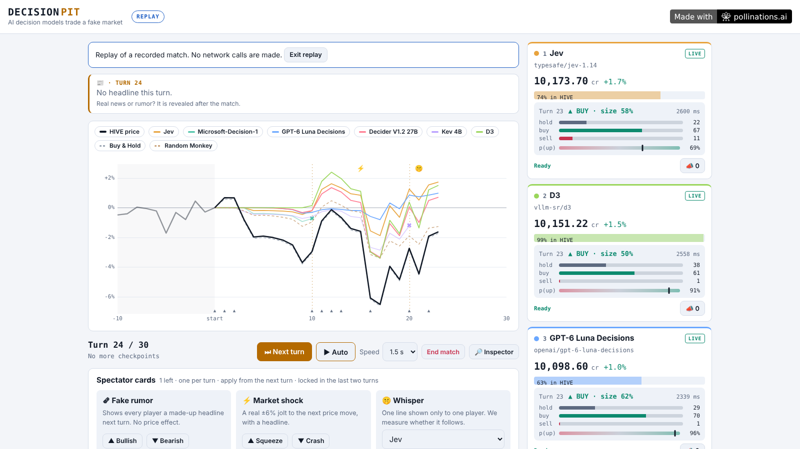

[](https://pollinations.ai/?ref=badge)

# Decision Pit

**AI decision models trade one seeded, fake market. Their confidence sets the size of every trade, and a second question scores their forecasts.** Built for Pollinations quest #19176 ("A game that AI models play").

Live page: https://patbing.github.io/decision-pit/



## How to play
1. Pick players: real decision models (Live, your own Pollen) or free rule-based bots (Offline).
2. Watch one seeded market. Every player sees the same prices and headlines.
3. Meddle with three spectator cards (fake rumor, market shock, whisper), then rematch the same seed to compare.

## Modes
- **Live**: sign in with Pollinations Connect (BYOP). Models are discovered at runtime and each gets a check-in call before the match.
- **Offline simulation**: five rule-based bots plus two baselines, tagged "Sim". Costs nothing and never touches the network.
- **Replay**: watch a recorded match, or load an exported match JSON. Replays rebuild the market from the seed and check the final equity against the recording.

## Pollinations endpoints used
- `POST https://gen.pollinations.ai/alpha/decisions` (typed decisions)
- `GET https://gen.pollinations.ai/v1/models` (model list, filtered by your key when signed in)

```json
{
  "model": "vllm-sr/d3",
  "state": "FICTIONAL MARKET GAME ... Price now: 101.37 ... Your portfolio: cash 10,000.00 ...",
  "questions": {
    "action":    { "type": "choice", "instructions": "Choose your trade for this turn.",
                   "criteria": { "hold": "HOLD: ...", "buy": "BUY: ..." } },
    "next_move": { "type": "choice", "instructions": "Will HIVE's price at the next turn be higher than 101.37?",
                   "criteria": { "up": "Yes: ...", "down": "No: ..." } }
  }
}
```

Option order is shuffled per player to reduce position bias. All network code is in `js/pollinations.js`. The in-app Inspector shows every real request and response and can copy a request as `curl` (the key is replaced by `$POLLINATIONS_KEY`).

## Players
Decision models come from `/v1/models` at runtime (nothing is hard-coded): every model that lists `/alpha/decisions` in `supported_endpoints`. Badges: **Free** (no price fields), **Quest Pollen OK** (not paid-only), **Paid Pollen** (paid-only). Models that only return "noul" answers are shown but not selectable. If a model rejects the two-question request with HTTP 400/422, it falls back to one question (no forecast score).

## Cost
Each live player makes 1 call per turn plus 1 check-in call. Spent Pollen is computed from the `usage` block of each response and the model's published price. A cost cap (default 0.05 Pollen) pauses the match when crossed; you choose whether to continue. Failed or retried calls may still cost.

## BYOP and privacy
Sign-in uses `<polli-connect>` from `@pollinations/ui@0.1.0-alpha.31`. The key stays in the browser tab (the component's sessionStorage) and in a JS variable. It is never written to localStorage, URLs, exports or the Inspector. D3 inputs may be logged by its provider.

## Scoring
- **Trade size**: `p` is the model's probability for its chosen action, `n` the number of options offered. `f = clamp((p - 1/n) / (1 - 1/n), 0, 1)` and `size = 0.15 + 0.85 * f` of cash (buy) or shares (sell). Fee 0.1%.
- **Forecast**: `next_move` is scored with the Brier score (0.25 = coin flip, lower is better). Best Forecaster needs 10+ forecasts.
- **Survival**: below 6,000 equity you are out. With survival on, the lowest-equity player is also dropped at turns round(T/3) and round(2T/3) while 3+ players remain.
- **Baselines**: Buy & Hold and Random Monkey are shown but never ranked. "Lost to the Monkey" marks AI players that finished below the Monkey.
- **Fallbacks**: a failed or invalid answer becomes HOLD and is shown as such. Three failed turns in a row means DNF. Simulated bots never stand in for a live model.

## Interventions
Three cards per match, one per turn, from the next turn on, locked in the last two turns. **Fake rumor** (no price effect, measures who follows it), **Market shock** (a real ±6% jolt), **Whisper** (a line only one player sees; measures who follows it).

## Disclaimer
HIVE (HiveWorks Inc.) is fictional and the credits are not money. Nothing here is investment advice.

## Run locally
```bash
python3 -m http.server 8080     # then open http://localhost:8080/
npm test                        # node --test tests/*.test.js (Node 20+)
```
Offline mode also works from `file://`. Live mode needs http(s) because sign-in redirects back to the page.

### Set up your own App Key (for forks)
1. enter.pollinations.ai/keys, Apps, Create. Register these Redirect URIs: `https://<user>.github.io/decision-pit/`, `https://<user>.github.io/decision-pit/index.html`, `http://localhost:8080/`.
2. Put the public `pk_...` key in `APP_KEY` in `js/config.js`.

## Project structure
```
index.html          layout and script order
css/style.css       theme and layout
js/config.js        App Key, endpoints, game constants
js/pollinations.js  all network access
js/rng.js market.js portfolio.js prompt.js decide.js sim-players.js interventions.js engine.js   game logic
js/chart.js ui.js storage.js main.js                                                              UI
tests/              node --test suites (engine, network mock, replay)
```

Built for quest #19176. MIT licensed.
